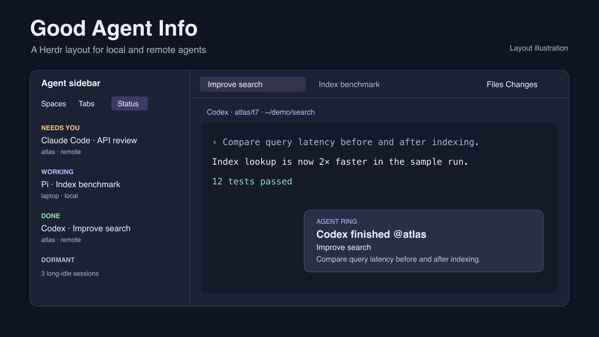

# Custom

A compact coding workspace with a combined Spaces/Tabs/Status sidebar, a horizontally scrolling tab bar, and an agent-aware pane header. The sidebar groups work by project and tab, while the right panel can show files or Git changes.

## What you see

- A 268 px left sidebar with a 46 px workspace chrome header, the Better Sidebar lists view, and a 28 px footer.
- Better Sidebar offers Spaces, Tabs, and Status views. It groups workspaces by machine, nests Git worktrees, shows agent status and sub-agent trees, and displays repository and pull-request details when available.
- A 42 px tab bar above the main work area. Tabs scroll horizontally, show their number and activity state, and provide Files and Changes panel controls. Unnamed tabs follow the current agent title when it describes the task, including session names containing `@`.
- The main pane uses a 30 px agent-aware header with the program icon, terminal's launch name (or program name), terminal address, working directory, status, and pane actions on hover.
- A hidden 368 px right panel contains Files and Changes. The 28 px workspace status bar remains along the bottom.
- Colors and borders use Herdr theme tokens. The layout leaves the terminal background, pane border, focus border, and window chrome tied to the selected theme.

## How it behaves

- Spaces, Tabs, and Status switch the sidebar list. Space and agent groups can be folded. Spaces can be moved within their machine, and sidebar width controls the compact rail.
- Agent rows show working, blocked, done, and idle states. Sub-agents appear as a tree. Rows focus their pane, and hovering an agent exposes pinning controls.
- The tab bar follows the active tab, scrolls long names, supports drag reordering and double-click rename, and opens the tab menu on right-click.
- The Files and Changes controls select or hide the right panel. Its selection is remembered per space.
- The pane header focuses its pane. Hovering reveals split, zoom, and close actions.
- The terminal right-click menu supports splitting, zooming, parking, closing, copying a terminal address, changing right-click routing, and moving a pane to another tab.
- Better Sidebar reads Git metadata for visible workspaces and watches local repositories for changes. Pull-request status is optional and uses the installed GitHub CLI (`gh`) with the user's existing authentication. The Files and Changes panels run Git commands and read files in the active workspace. Remote workspaces use Herdr's configured machine connection.

## Built from

- `layouts/Custom.json` defines the sidebar, work area, tab bar, pane header, right panel, status bar, and terminal menu.
- `mods/better-sidebar/` provides the combined workspace and agent lists, Git metadata, and optional GitHub pull-request status.
- `mods/tabs-marquee/` provides the tab bar and per-space panel selection.
- `mods/agent-name-pane/` provides the agent-aware pane header.
- `mods/workspace-chrome/` and `mods/workspace-status/` provide the top and bottom workspace bars.
- `mods/files/` and `mods/changes/` provide the right-side file browser and Git change view.
- `mods/my-menu/` provides the terminal context menu and pane-to-tab picker.

## Requirements

- Herdr App 0.1.16 or a compatible release with the `gpui-kit` and `herdr` mod APIs used by these mods.
- `git` for repository details and the Changes panel.
- `gh` is optional. Without it, disable `pull_request_status` in Better Sidebar's mod settings.
- A configured Herdr machine connection is needed to show remote spaces and their repository details.

## Install

Copy `layouts/Custom.json` into `~/.config/herdr-app/layouts/` and each folder under `mods/` into `~/.config/herdr-app/mods/`. Run `herdr-app check ~/.config/herdr-app/mods/better-sidebar`, `herdr-app check ~/.config/herdr-app/mods/tabs-marquee`, and `herdr-app check ~/.config/herdr-app/mods/agent-name-pane`, then switch to the Custom layout from the layout picker.
